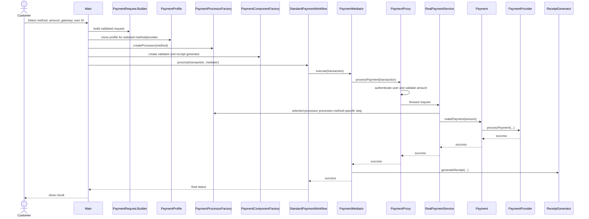

# Smart Payment Processing and Failure Handling System — UML Documentation

## Scope and assumptions

This is a Java console simulation. Gateway interactions are simulated, transactions are held in an in-memory `TransactionStore`, and there is no real banking integration or persistent database. The system demonstrates 11 core patterns: Factory Method, Abstract Factory, Bridge, Proxy, Chain of Responsibility, Builder, Prototype, Mediator, Template Method, Strategy, and Memento. `TransactionStore` additionally uses Singleton as a supporting implementation detail.

## 1. Class diagram

See [`UML_CLASS_DIAGRAM.png`](UML_CLASS_DIAGRAM.png) or [`UML_CLASS_DIAGRAM.svg`](UML_CLASS_DIAGRAM.svg). The editable Graphviz source is [`UML_CLASS_DIAGRAM.dot`](UML_CLASS_DIAGRAM.dot).

### Pattern participants

1. **Factory Method** — `PaymentProcessorFactory` creates one of `UPIPaymentProcessor`, `CardPaymentProcessor`, `NetBankingPaymentProcessor`, or `WalletPaymentProcessor`. `RealPaymentService` uses the selected processor for method-specific processing before gateway delegation.
2. **Abstract Factory** — `PaymentComponentFactory` has concrete UPI/Card/Net Banking/Wallet factories that create the matching `PaymentValidator` and `ReceiptGenerator` products.
3. **Bridge** — `Payment` holds a `PaymentProvider`; `UPIPayment`, `CardPayment`, `NetBankingPayment`, and `WalletPayment` can use `GatewayA`, `GatewayB`, or `GatewayC` without one subclass per combination.
4. **Proxy** — `PaymentProxy` implements `PaymentService`, authenticates a simulated user, checks the amount limit, and delegates to `RealPaymentService`.
5. **Chain of Responsibility** — `ValidationFailureHandler → GatewayFailureHandler → RetryHandler → SupportHandler` handles simulated failures.
6. **Builder** — `PaymentRequest.Builder` assembles the payment request and validates required fields and amount.
7. **Prototype** — `PaymentProfile.copyFor(...)` clones a reusable profile and customizes the copy for the selected method and provider.
8. **Mediator** — `PaymentMediator` coordinates the validator, `PaymentService`, and receipt generator rather than having each component coordinate the others.
9. **Template Method** — `PaymentWorkflowTemplate.process(...)` fixes the workflow order; `StandardPaymentWorkflow` implements the before/after hooks.
10. **Strategy** — `RetryStrategy` abstracts retry limits and decisions; `StandardRetryStrategy` supplies the demo policy used by `RetryHandler`.
11. **Memento** — `Transaction.saveState()` creates an opaque `TransactionMemento`, and `restoreState(...)` restores status and failure reason between simulated retry attempts.

## 2. Use-case diagram (textual specification)

**Actor — Customer**
- Select payment method and gateway
- Enter payment amount and user ID
- Make payment
- View transactions
- Simulate a payment failure

**System responsibilities**
- Build and validate the request
- Clone a reusable payment profile
- Create method-specific processor and related components
- Validate user access and amount through the proxy
- Process via the selected payment method and gateway
- Generate a receipt on success
- Route failures through handlers and retry policy
- Save/restore transaction state during retries

**Actor — Support Team (simulated)**
- Receive escalated failures after retries are exhausted

## 3. Sequence diagram — successful payment



## 4. Sequence diagram — failed payment and retry

```mermaid
sequenceDiagram
    participant Main
    participant Transaction
    participant Validation as ValidationFailureHandler
    participant GatewayHandler as GatewayFailureHandler
    participant Retry as RetryHandler
    participant Strategy as RetryStrategy
    participant Memento as TransactionMemento
    participant Support as SupportHandler

    Main->>Transaction: set simulated failure and reason
    Main->>Validation: handle(transaction, failureType)
    Validation->>GatewayHandler: pass unhandled failure
    GatewayHandler->>Retry: pass recoverable gateway failure
    Retry->>Transaction: saveState()
    Transaction-->>Retry: memento checkpoint
    loop Retry attempts
        Retry->>Strategy: shouldRetry(...)
        Retry->>Strategy: simulatedRetrySucceeds(attempt)
        alt Retry succeeds
            Retry->>Transaction: status = SUCCESS; clear failure reason
        else Attempt fails
            Retry->>Transaction: restoreState(checkpoint)
        end
    end
    opt All attempts fail
        Retry->>Support: handle unresolved failure
        Support->>Transaction: status = ESCALATED
    end
```

## 5. Activity flow

1. Start and collect payment details.
2. Build `PaymentRequest`; clone `PaymentProfile`.
3. Create processor and matching validator/receipt components.
4. Create transaction and pair payment abstraction with provider.
5. Template Method invokes Mediator.
6. Mediator validates; Proxy authenticates and checks amount.
7. Real service invokes the selected processor and Bridge gateway.
8. On success, generate receipt; on failure, set failure details.
9. For a simulated failure, run the handler chain; retry policy and memento manage attempts and state.
10. If retry is successful, mark success; otherwise escalate unresolved errors.

## 6. Transaction states

`CREATED → VALIDATING → PROCESSING → SUCCESS`

Recoverable simulated failure: `PROCESSING → FAILED → RETRYING → SUCCESS`.

Unresolved failure: `PROCESSING → FAILED → RETRYING → ESCALATED`.

Non-recoverable validation/authentication errors can transition directly to `FAILED`.
